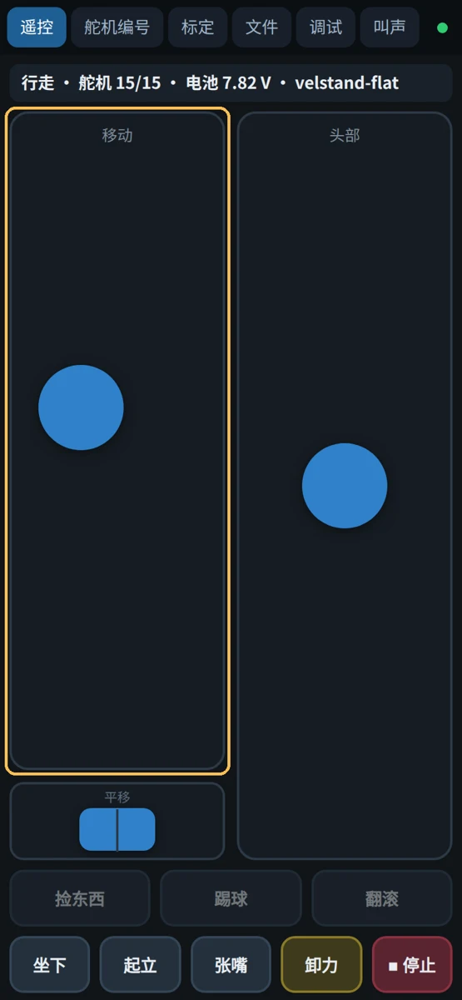
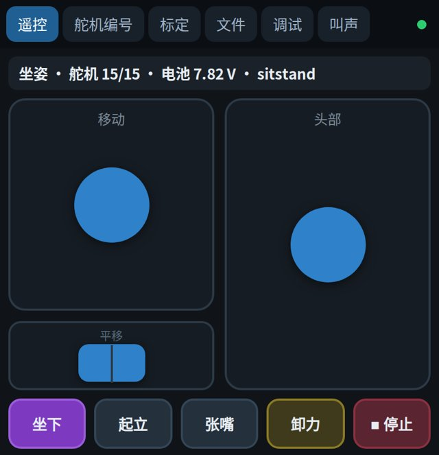
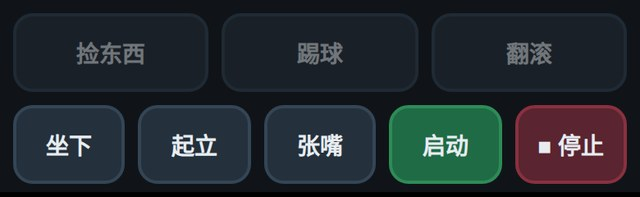
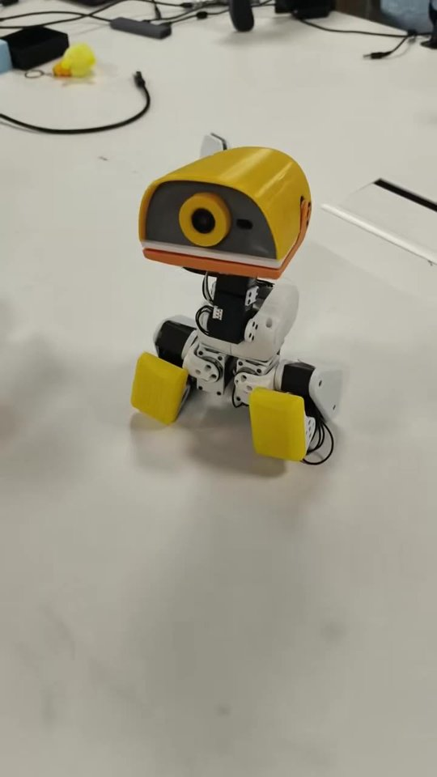

# 基础使用

所有动作都在遥控页 `http://192.168.4.1` 上操作。

## 站起来

把小鸭子放在平地上，四周留出空地，手在旁边虚扶。点「启动」并确认，它在约 3 秒内缓缓起身到站立姿态，随后由策略接管。状态条依次显示「起身中」「站立」。

<figure class="duck-figure">
  <video class="duck-motion" controls muted playsinline preload="none" width="540" height="540" poster="_static/deck/stand.webp" src="_static/deck/stand.mp4" aria-label="仿真演示：小鸭子起身站稳"></video>
  <figcaption>现场课仿真演示 · 从放松姿态起身，到双脚站稳。</figcaption>
</figure>

这个按钮同时也是卸力开关：站立时显示「卸力」，卸力后显示「启动」。卸力会让全身关节立刻放松，所以要先扶住它，或者放到架子上，再点「卸力」。

## 走路

  <figure class="duck-figure duck-phone">
    
    <figcaption>左边是移动摇杆。上下推前进或后退，左右推转向。</figcaption>
  </figure>
  <figure class="duck-figure">
    <video class="duck-motion" controls muted playsinline preload="none" width="540" height="540" poster="_static/deck/walk.webp" src="_static/deck/walk.mp4" aria-label="仿真演示：小鸭子前进、转向和停下"></video>
    <figcaption>现场课仿真演示 · 前进、边走边左转，最后松开摇杆停下。</figcaption>
  </figure>

| 控件 | 操作 | 效果 |
| --- | --- | --- |
| 移动摇杆（左） | 前后推 | 前进、后退 |
| 移动摇杆（左） | 左右推 | 边走边转向 |
| 平移滑块（左下） | 左右拨 | 不转身，横着平移 |
| 头部摇杆（右） | 左右推 | 头部左右转（偏航） |
| 头部摇杆（右） | 上下推 | 抬头、低头（俯仰） |

摇杆从小推到大，先慢走，再加速。

松开摇杆，它会在半秒内慢慢停下。「停止」按钮会立刻把速度清零，行走时慎用。出现异常时，扶住它，关掉电源开关。

用电脑打开页面时也可以用键盘：`W`、`S` 前进后退，`Q`、`E` 转向，`A`、`D` 平移，空格停止。

## 张嘴、坐下与起立

{w=360px}

点「张嘴」，嘴部舵机张开，再点一次合上。点「坐下」，它坐下来；点「起立」，它站起来。

## 捡东西、踢球、翻滚

站着的时候，遥控页底部上面一排的「捡东西」「踢球」「翻滚」可以点：点一下，它做一遍对应的动作，做完自己回到站立。其余状态下这三个按钮是灰的，下图里小鸭子还没启动，所以也是灰的。

{w=360px}

| 按钮 | 动作 | 点之前 |
| --- | --- | --- |
| 捡东西 | 低头，用嘴尖点一下地面，再站回来 | 嘴前方留出空地 |
| 踢球 | 右脚往前踢 | 它看不到球，球要放在右脚前方 |
| 翻滚 | 向前翻一个跟头，落回脚上 | 把周围清空，放在平整的地面上 |

## 倒地起身

小鸭子被推倒后，约 1 秒开始自己起身，不用任何操作。起身完成后，摇杆如果还推着，它会继续走。

{w=280px}

## 语音命令

对着小鸭子说「小鸭小鸭」，它叫一声应答，接着可以连续说命令。4 秒没有人说话，它就回到等待唤醒的状态。

| 类别 | 命令词 |
| --- | --- |
| 动作 | 前进、后退、左转、右转、坐下、起立 |
| 叫声 | 叫一声、打招呼、报警、嘀咕、滑行、啄一下、啾一声、询问 |

语音的「前进」「后退」和转向只保持一小段时间，到时间自动回到站立。

## 看实时数据

调试页 `http://192.168.4.1:84` 实时显示状态、电池电压、舵机在线数、闭环频率、关节角度和 IMU 读数。站立、行走时闭环频率应为 50 Hz，舵机应为 15/15。

叫声页 `http://192.168.4.1:85` 可以播放已载入的各种叫声。
