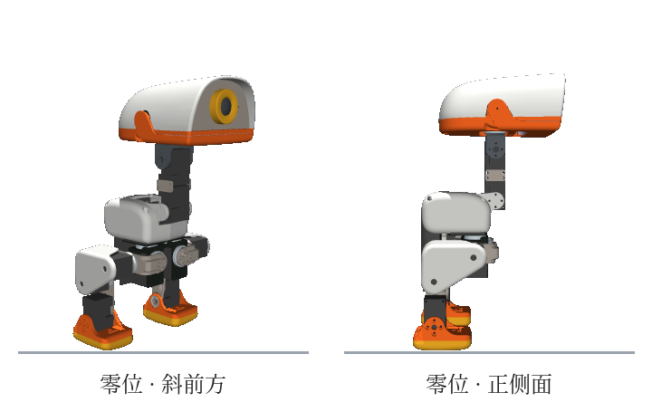
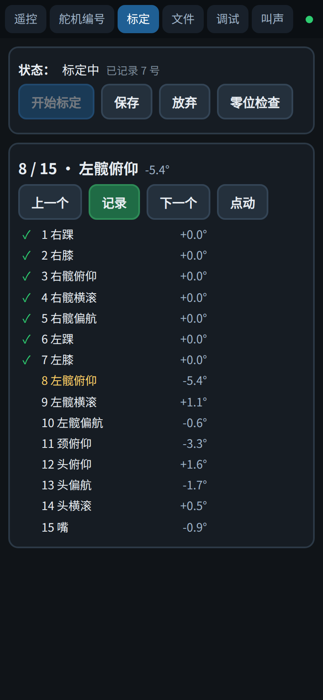

# 上电标定

散件装好后，或更换舵机、重新装舵盘后，先标定再启动。收到已标定的整机且没有拆动关节，可以直接看[基础使用](basic-use.md)。

标定是把每个关节在**装配零位**时的读数记下来。装配零位是下图里的机械参考姿态，不是遥控时的站立姿态；也不是在网页上把旧读数调到 `0°`。

{w=650px}

## 逐个记录零位

1. 按[上电与连接](power-on.md)连上小鸭子的热点。稳稳托住机身或把它放在支架上，让关节能自由摆动。遥控页如果显示「卸力」按钮，先托住机身再点「卸力」并确认；如果已经显示「启动」，不要点。卸力后小鸭子不能自己支撑。
2. 打开「标定」页（`http://192.168.4.1:82`），点「开始标定」并确认。页面显示「标定中」。
3. 看页面选中的编号与关节名称，用手把对应关节摆到图示零位，扶稳后点「记录」。看到该关节行出现 `✓` 才算记录成功，页面会自动选中下一号。也可以点列表中的关节行重新选择。
4. 首次标定要等 1–15 号全部打勾。先保持「标定中」，按下一节核对方向，再保存。

{w=360px}

## 用「点动」核对方向

点动只能在「标定中」使用。关节摆在有活动余量的位置，选中编号，手避开活动部件，再点「点动」。只有选中的关节会朝正方向小幅转动，然后回到起点。等它停下再核对下一号。

{download}`下载关节方向原图 <images/calibration-joint-directions.png>`

15 号嘴部以合拢为零位，点动的正方向是张嘴。若动的是别的关节，先查舵机编号；若方向不对、卡住或不动，先停下检查，别启动。整机的「零位检查」只看回零后的姿态，不能代替点动核对方向。

## 检查后再启动

1. 确认首次标定的 15 个关节都已打勾，再点「保存」。若页面提示有未记录的关节，先取消保存并补齐；跳过的关节会沿用原零位。保存后小鸭子仍处于卸力状态。不要在「标定中」直接点「零位检查」：那也会保存本次记录。
2. 仍托住机身，手离开关节，给腿和头留出空间。点「零位检查」并确认。舵机会重新出力，各关节主动转向刚才保存的零位。
3. 对照上面的整机零位图，看脚、腿、头是否摆正。检查完扶稳机身，点「放弃」结束检查，回到「已卸力」。这里的「放弃」是**退出检查**，不会撤销刚才已保存的零位。
4. 检查通过后，把小鸭子放在平地上，按[基础使用](basic-use.md)里的步骤启动。若姿态明显不对、转动受阻，立即退出检查；若仍在顶住或不受控，关电源。排除接线、编号或装配问题后再重新标定。

若关节显示「无响应」或点「记录」不打勾，先检查接线和舵机编号。若某个关节只能往一边转，检查舵盘是否装偏、零位是否靠近舵机行程的一端；按[装配准备](assembly/prep.md)让舵机先「回中位」，再装舵盘、重新标定。不要硬掰关节。
