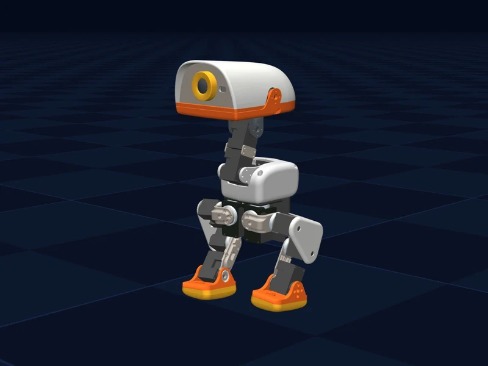

# 02 强化学习的数学表达

智能体与环境、观测、动作与奖励，回合与回报、折扣因子，随机策略与训练目标；最后把小鸭子的仿真环境装起来，让它走一步、走一段。

  

    
主线 02 · 智能体与环境

    
策略与环境怎样交换信息？

    <ol class="duck-steps">
      <li>仿真环境把<strong>观测</strong>交给策略。</li>
      <li>策略选出<strong>动作</strong>，由小鸭子执行。</li>
      <li>环境给出<strong>奖励</strong>和下一步观测。</li>
    </ol>
  

  

<iframe src="https://player.bilibili.com/player.html?isOutside=true&amp;aid=117541259186568&amp;bvid=BV1xExx6jEGW&amp;cid=43240456914&amp;p=1&amp;autoplay=0" loading="lazy" title="课程 02：强化学习的数学表达" allowfullscreen></iframe>

## 动手

打开 [本讲 notebook](https://github.com/Xbotics-Embodied-AI-club/Xbotics-MiniDuck-Course/blob/main/notebooks/M02-rl-math/m02_env.ipynb)。仿真环境跑在显卡上，需要一台带 NVIDIA 显卡的 Linux 电脑。

新版 notebook 使用硬件版本 {{hardware}}。运行时以 notebook 为准，不要照抄视频里的旧版本号。
