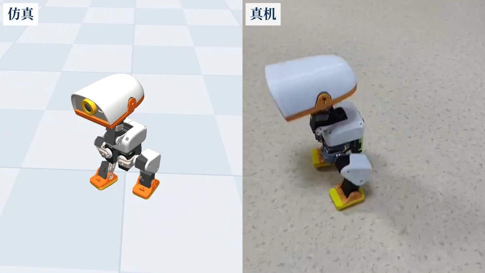

# 课程表

《小鸭子带你学强化学习》分两条线。主线 9 讲是实操，按顺序学：从强化学习的基本概念讲起，亲手训练、量化，最后把自己训的策略部署到小鸭子真机上。选修 5 讲讲强化学习的推导，给想深入的同学。每一讲是一集视频，动手的部分在仓库的 `notebooks/` 里，一讲一个文件夹，文件夹名就是讲次（如 `M02-rl-math/`）。

<figure class="duck-figure">
  
  <figcaption>现场课 · 从仿真训练，到真机复现。</figcaption>
</figure>

<h2>先看这几讲</h2>

::::{container} duck-grid duck-grid-three
:::{container} duck-card
[主线 01 · 上手 MiniDuck](01-miniduck.md)

连热点、用手机遥控，认识机身里的舵机和传感器。
:::
:::{container} duck-card
[主线 02 · 强化学习的数学表达](02-rl-problem.md)

从智能体、环境和回报讲起，动手跑一次仿真。
:::
:::{container} duck-card
[选修 S1–S2 · 价值函数与 DQN](03-value-bellman.md)

先用三格走廊推导，再到悬崖行走和倒立摆上练习。
:::
::::

## 主线

| 讲次 | 主题 | |
| --- | --- | --- |
| 01 | 上手 MiniDuck | [观看](01-miniduck.md) |
| 02 | 强化学习的数学表达：智能体、环境与回报 | [观看](02-rl-problem.md) |
| 03 | 一集讲清 PPO：沿着回报往上爬 | 制作中 |
| 04 | 跑通一次训练：从零练平地直走 | [Notebook](https://github.com/Xbotics-Embodied-AI-club/Xbotics-MiniDuck-Course/tree/main/notebooks/M04-train) |
| 05 | 改奖励：从出厂走路权重续训 | [Notebook](https://github.com/Xbotics-Embodied-AI-club/Xbotics-MiniDuck-Course/tree/main/notebooks/M05-reward) |
| 06 | 仿真建模与真机对齐 | 制作中 |
| 07 | 域随机化与多动作训练 | 制作中 |
| 08 | 模型量化与真机部署 | 制作中 |
| 09 | 编辑自己的动作 | 制作中 |

## 选修

| 讲次 | 主题 | |
| --- | --- | --- |
| S1 | 价值函数与贝尔曼方程 | [观看](03-value-bellman.md)（视频前半） |
| S2 | 时序差分与 DQN | [观看](03-value-bellman.md)（视频后半） |
| S3 | 策略梯度与 REINFORCE | [Notebook](https://github.com/Xbotics-Embodied-AI-club/Xbotics-MiniDuck-Course/tree/main/notebooks/S03-policy-gradient) |
| S4 | Actor-Critic 与广义优势估计 | [Notebook](https://github.com/Xbotics-Embodied-AI-club/Xbotics-MiniDuck-Course/tree/main/notebooks/S04-actor-critic) |
| S5 | 从 TRPO 到 PPO | [Notebook](https://github.com/Xbotics-Embodied-AI-club/Xbotics-MiniDuck-Course/tree/main/notebooks/S05-trpo-ppo) |

## 打开 notebook

先照[仿真器](../simulator.md)装好环境，然后在仓库目录里：

```bash
uv run jupyter lab notebooks/
```

训练需要一台带 NVIDIA 显卡的 Linux 电脑。

## 主线 04：从零练平地直走

打开 `notebooks/M04-train/m04_train.ipynb`，用仓库里的 PPO 从随机初始化的网络开始训练。Notebook 用 `course-walk` 演示 300 轮；要跑完整的 6000 轮，按[动手代码说明](https://github.com/Xbotics-Embodied-AI-club/Xbotics-MiniDuck-Course/tree/main/notebooks#课上的动手代码)里的命令启动。小鸭子先练平地向前走，随后训练加入质心变化和轻推。评测时看它能否持续向前、保持方向。这一讲不练后退、转圈或跌倒起身。

## 主线 05：从出厂走路权重续训

打开 `notebooks/M05-reward/m05_reward.ipynb`。两组都读仓库自带的 `checkpoints/m05_factory_walk.pt`，在 `course-walk` 各续训 300 轮。一组保留脚的滞空奖励，另一组把这项权重设为零。训练结束后对照录像，再比较左右脚的腾空时长和抬脚高度。`policies/` 里的 `.mdp` 是推理文件，不能替代训练检查点。

## 选修 S03–S05：手写三版训练方法

按 S03 → S04 → S05 跑。三讲用同一个 `course-walk-elective` 任务练平地直走；后两讲在比较阶段会读取前面保存的权重。S05 的 PPO 训练跑 1500 轮。

