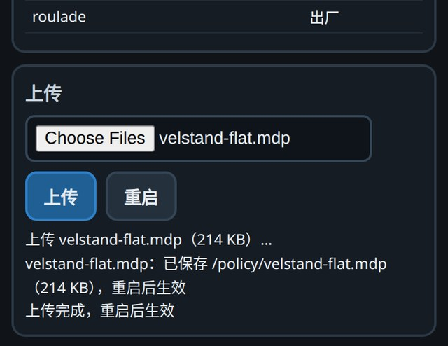
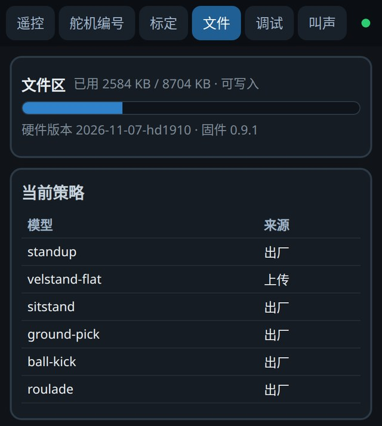
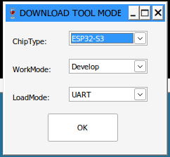
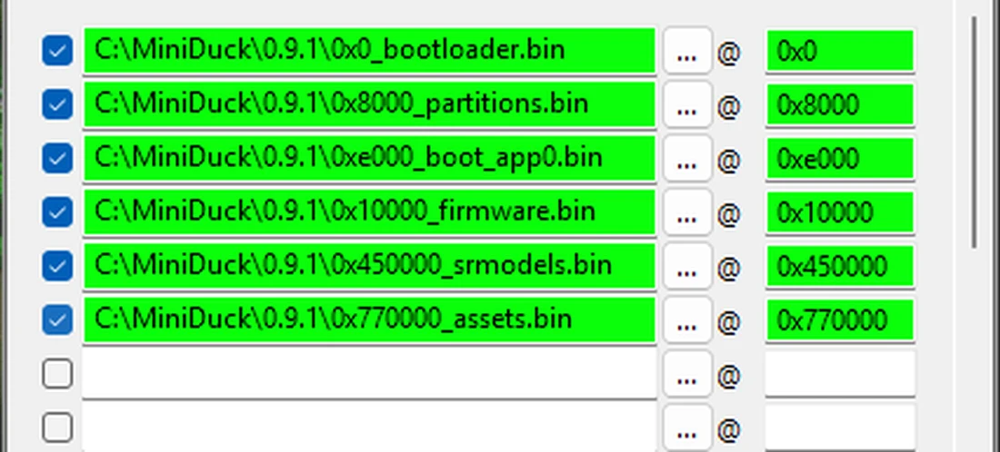
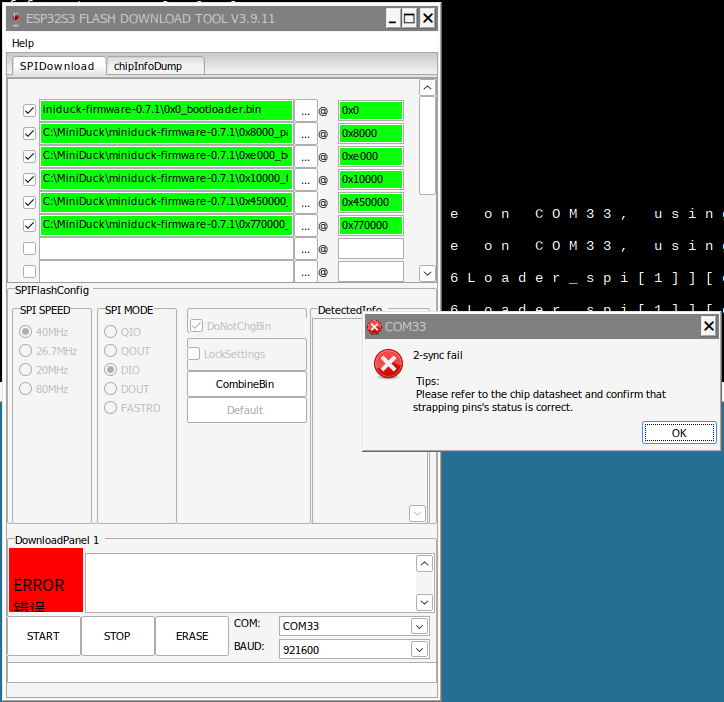

# 固件与策略更新

固件和策略分开更新。固件用 USB 线烧写，策略在网页上传就行，不用接电脑线。

::::{container} duck-grid
:::{container} duck-card
[网页更新策略](#网页更新策略)

只换动作模型：手机或电脑连小鸭子的热点即可。
:::
:::{container} duck-card
[烧写固件](#烧写固件)

刷程序或初始化新板：需要 Windows 电脑和 USB-C 数据线。
:::
::::

当前版本：固件 {{firmware}}，硬件版本 {{hardware}}。

## 网页更新策略

策略是 `.mdp` 文件，文件名就是模型名。

| 文件 | 模型 |
| --- | --- |
| `standup.mdp` | 站立与倒地起身 |
| `velstand-flat.mdp` | 行走 |
| `sitstand.mdp` | 坐下与起立 |
| `ground-pick.mdp` | 捡东西 |
| `ball-kick.mdp` | 踢球 |
| `roulade.mdp` | 翻滚 |

出厂策略的 `.mdp` 文件在仓库的 {{policy_dir}} 目录下。只能上传同一个硬件版本训练出来的策略，版本不对时板子会拒收。

**固件已经是 0.9.0 的**：固件程序不用重烧，只要上传仓库里新的起身和走路两个文件：`standup/standup.mdp` 和 `velstand-flat/velstand-flat.mdp`。固件是 0.8.1 或更早的，按下面[烧写固件](#烧写固件)把六个文件全烧。

1. 手机或电脑连上小鸭子的热点。
2. 打开遥控页 `http://192.168.4.1`，点「卸力」。站立和行走时不能上传，文件页的上传、重启按钮是灰的。
3. 打开文件页 `http://192.168.4.1:83`，在「上传」一栏选择 `.mdp` 文件（可以多选），点「上传」。页面提示「已保存，重启后生效」。

   {w=320px}

4. 点「重启」。热点断开约 15 秒后恢复，重新连上。
5. 回到文件页，「当前策略」表里这个模型的来源变成「上传」。

   {w=320px}

上传的文件损坏、硬件版本不对或文件名不是模型名时，板子当场拒收，原来的文件不动。上传的策略开机载入失败时，自动退回出厂策略，来源一栏会写明原因。

**恢复出厂**：文件页最下面的「恢复出厂」删除全部上传的策略和叫声并重启，回到出厂文件。出厂文件不会被删除。

也可以在电脑上用仓库里的命令行工具上传。先在能上网时按[仿真器](simulator.md)页装好环境，再连小鸭子的热点，然后在仓库根目录运行：

```bash
uv run firmware/tools/assets.py upload policies/2026-11-07-hd1910/velstand-flat/velstand-flat.mdp --reboot
uv run firmware/tools/assets.py ls        # 列出板上的文件
uv run firmware/tools/assets.py restore   # 恢复出厂
```

## 更换叫声

叫声是 16 kHz 单声道 WAV，文件名是 `<叫法>_<变体号>.wav`。叫法有 `alarm`、`greet`、`inquire`、`peck`、`chirp`、`coo`、`wheee_start`、`wheee_loop`、`wheee_end`，变体号 0–9。同名文件替换出厂的那一段，新的变体号是增加一段。

常见音频可以用工具转换成板上的格式，再按上面的步骤在文件页上传。在仓库根目录运行：

```bash
uv run firmware/tools/assets.py audio 我的叫声.mp3 --as greet_3
```

## 烧写固件

需要一台 Windows 10 或 11 电脑和一根能传数据的 USB-C 线。全套烧写约 2 分钟，只更新固件约 30 秒。

### 下载

| 文件 | 说明 |
| --- | --- |
| {{firmware_link}} | 编译好的固件，就在仓库里：六个 `.bin` 文件和一份 `烧写地址.txt` |
| {{tool_link}} | 乐鑫 Flash 下载工具，解压就能用，不用安装 |

已经 `git clone` 过仓库的，直接用仓库里的 {{firmware_dir}}。没有的话，在[仓库主页](https://github.com/Xbotics-Embodied-AI-club/Xbotics-MiniDuck-Course)点 Code → Download ZIP 下载整个仓库。

烧写工具读不了含中文的路径。把烧写工具和仓库里的 {{firmware_dir}} 文件夹放在不含中文的路径下，比如 `C:\MiniDuck\`。

### 连接电脑

USB-C 线一头插头板，一头插电脑。打开「设备管理器」→「端口 (COM 和 LPT)」，找到 `USB-SERIAL CH340 (COMx)` 这一行，记下串口号。

没有这一行时，先换一根能传数据的线；还没有就安装[沁恒 CH341SER 驱动](https://www.wch.cn/downloads/CH341SER_EXE.html)，装完拔插一次 USB 线。

### 打开工具

运行 `flash_download_tool_3.9.11.exe`，ChipType 选 **ESP32-S3**，WorkMode 选 Develop，LoadMode 选 UART，点 OK。

{w=320px}

### 填文件和地址

在 SPIDownload 页逐行选择文件：点行尾的「...」选文件，在 `@` 后面填地址，勾上最左边的框。填对后，文件框和地址框都变绿。文件名前面就是它的地址。

| 文件 | 地址 | 什么时候烧 |
| --- | --- | --- |
| `0x0_bootloader.bin` | `0x0` | 全套烧写 |
| `0x8000_partitions.bin` | `0x8000` | 全套烧写 |
| `0xe000_boot_app0.bin` | `0xe000` | 全套烧写 |
| `0x10000_firmware.bin` | `0x10000` | 每次更新固件 |
| `0x450000_srmodels.bin` | `0x450000` | 全套烧写 |
| `0x770000_assets.bin` | `0x770000` | 全套烧写；会清掉上传的策略和叫声 |

先打开文件页，看顶部的固件版本：

- **已经是 {{firmware}}**：不用烧。
- **0.9.0**：固件程序没变，不用烧；要换成新的起身和走路，按上面「网页更新策略」上传两个文件。
- **0.8.1 或更早的固件、新板子、要整块恢复**：六行全填、全勾。零点标定和调参留着，上传的策略和叫声会清掉。

保持 DoNotChgBin 勾选。右下角 COM 选刚才记下的串口号，BAUD 选 921600。

<figure class="duck-figure">
  
  <figcaption>全套烧写的六行示例：文件名与对应地址都应显示为绿色。</figcaption>
</figure>

### 烧写

点 START。工具自动让板子进入下载模式，状态块走完后显示「FINISH 完成」。

:::{container} duck-note
**不要点 ERASE。** 它会擦掉整片 flash，零点标定也会丢失。
:::

```{figure} images/flash-rows.png
:alt: 烧写工具完整主窗口。中间有 DoNotChgBin，左下角是 START、STOP、ERASE，右下角是 COM 和 BAUD。
:class: duck-figure

看完整窗口：右下角选 COM 和 BAUD，左下角点 START；不要点同一排的 ERASE。
```

烧完拔掉 USB 线再插上；身体板电源开着的话，关一下再开。

弹出「2-sync fail」时，板子没有进入下载模式：

{w=320px}

1. 核对 COM 号，关掉占用这个串口的软件，BAUD 改成 115200 再试。
2. 还不行就手动进入下载模式：头板 USB-C 口旁边有复位和下载两个按键。按住下载键，按一下复位键，松开下载键，然后点 START。

### 核对

连上小鸭子的热点，打开文件页 `http://192.168.4.1:83`。顶部的固件版本应为 {{firmware}}，硬件版本应为 {{hardware}}，「当前策略」表里六个模型都已载入。
