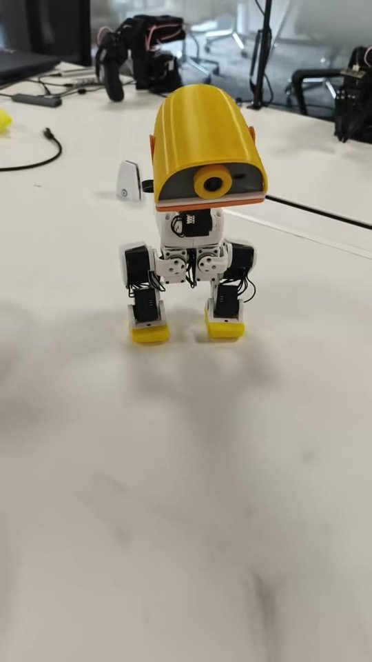

# 小鸭子 MiniDuck 使用手册

MiniDuck 是一台高约 25 厘米、质量约 0.78 千克的双足机器人，行走、抗扰动和跌倒恢复都由神经网络控制。

{w=320px}

拿到装好的小鸭子，从「上电与连接」开始，几分钟就能让它走起来。

| 我想 | 看这里 |
| --- | --- |
| 打开电源，用手机连上它 | [上电与连接](power-on.md) |
| 让它站起来、走路、坐下、听语音命令 | [基础使用](basic-use.md) |
| 更新固件，或者换一份策略 | [固件与策略更新](firmware.md) |
| 在电脑上看它在仿真器里走 | [仿真器](simulator.md) |
| 对照版本，看每次更新要做什么 | [版本与更新](versions.md) |

## 当前版本

| 项目 | 版本 |
| --- | --- |
| 手册与代码 | {{course_version}} |
| 硬件版本 | {{hardware}}（{{servo}}，{{board}}） |
| 固件 | {{firmware}} |

代码、仿真模型和策略都在 [GitHub 仓库](https://github.com/Xbotics-Embodied-AI-club/Xbotics-MiniDuck-Course)。

## 署名

作者：锟酱 · Xbotics 具身智能社区。

机器人的结构模型来自 [Pollen Robotics 的 microduck_rl](https://github.com/pollen-robotics/microduck_rl)。我们换了电池与电路板，按实称修正了质量，并换用飞特 HD-1910 舵机。

```{toctree}
:hidden:
:maxdepth: 2

power-on
basic-use
firmware
simulator
versions
```
