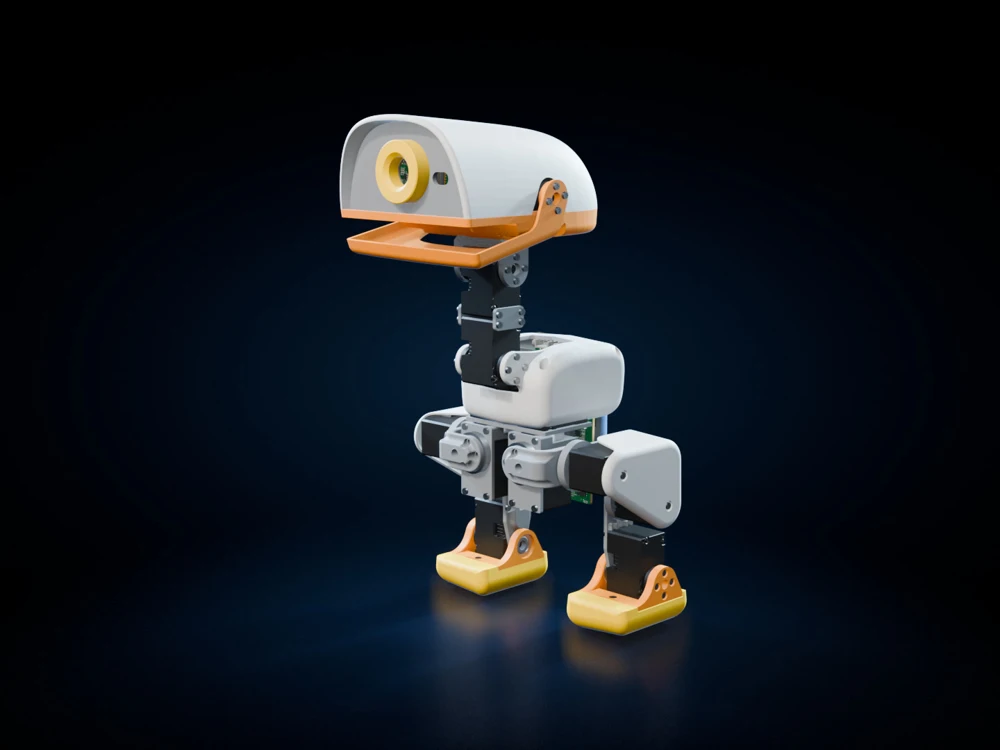

# 小鸭子 MiniDuck 使用手册

<div class="duck-hero">
  <div>
    <p class="duck-kicker">MINIDUCK · 使用教程</p>
    <p class="duck-lead">从零件到一只会走的小鸭子</p>
    <p>MiniDuck 是一台约 25 厘米高、0.79 千克重的双足机器人。跟着手册组装和遥控，再到仿真里看它怎么学会走路。</p>
    <p><a class="duck-action" href="assembly/index.html">从装配开始</a></p>
  </div>
  
</div>

## 选一条路线

::::{container} duck-grid
:::{container} duck-card
[01 · 散件装成整机](assembly/index.md)

先看部件和装配动画，再按章节装腿、胯和头。
:::
:::{container} duck-card
[02 · 上电与连接](power-on.md)

连小鸭子的热点，打开遥控和调试页面。
:::
:::{container} duck-card
[03 · 上电标定](calibration.md)

自己组装或换过舵机，先校准关节零位。
:::
:::{container} duck-card
[04 · 基础使用](basic-use.md)

对照遥控界面与动作演示，学会起身、行走和语音操作。
:::
:::{container} duck-card
[05 · 仿真器](simulator.md)

在电脑上跑出厂策略，不需要连接真机。
:::
:::{container} duck-card
[06 · 课程](course/index.md)

看视频，跟着 notebook 从仿真实验走到真机部署。
:::
::::

需要维护设备？查看[固件与策略更新](firmware.md)或[版本与更新](versions.md)。

## 当前版本

| 项目 | 版本 |
| --- | --- |
| 手册与代码 | {{course_version}} |
| 硬件版本 | {{hardware}}（{{servo}}，{{board}}） |
| 固件 | {{firmware}} |
| 出厂策略 | 起身 · 走路 · 坐站 · 捡东西 · 踢球 · 翻滚 |

代码、仿真模型和策略都在 [GitHub 仓库](https://github.com/Xbotics-Embodied-AI-club/Xbotics-MiniDuck-Course)。

## 署名

作者：锟酱 · Xbotics 具身智能社区。

仿真模型的来源与授权见 [LICENSE-MODELS.md](https://github.com/Xbotics-Embodied-AI-club/Xbotics-MiniDuck-Course/blob/main/LICENSE-MODELS.md)。我们换了电池与电路板，按实称修正了质量，并换用飞特 HD-1910 舵机。

```{toctree}
:hidden:
:caption: 装配

assembly/index
assembly/prep
assembly/right-leg
assembly/left-leg
assembly/hip
assembly/legs-on
assembly/neck
assembly/head
assembly/finish
```

```{toctree}
:hidden:
:caption: 使用

power-on
calibration
basic-use
firmware
simulator
versions
```

```{toctree}
:hidden:
:caption: 课程

course/index
course/01-miniduck
course/02-rl-problem
course/03-value-bellman
```
