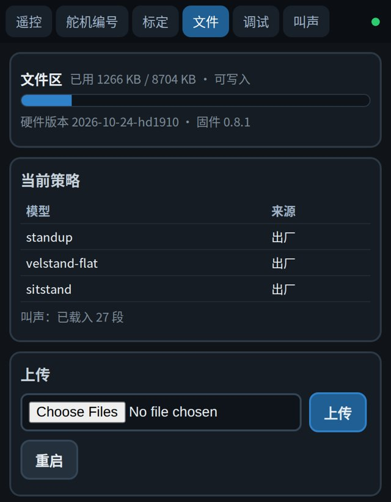

# 上电与连接

小鸭子不需要接电脑，也不需要装软件。手机连上它自己的 Wi-Fi 热点，所有操作都在浏览器里完成。

## 电池与充电

小鸭子用两节 18650 锂电池串联，满电 8.4 V。充电时把 USB-C 线插到身体板的 USB-C 口上，最大功率 15 W。

遥控页顶部的状态条显示当前电池电压。电压降到 6.8 V 时舵机会自动断电，这时需要充电。

## 开机

1. 把小鸭子放在平地上，打开身体板上的电源开关。
2. 手机打开 Wi-Fi，连接名为 `Xbotics-MiniDuck-XXXX` 的热点，没有密码。最后四位每台不同。
3. 这个热点不能上网，只用来连接机器人。手机提示「无互联网连接」时，选择保持连接。

## 确认版本

浏览器打开 `http://192.168.4.1:83`，这是文件页。

{w=320px}

检查两处：

- 顶部写着硬件版本 {{hardware}} 和固件版本，当前固件是 {{firmware}}。
- 「当前策略」表里有 `standup`、`velstand-flat`、`sitstand` 三个模型，来源都是「出厂」。

`standup` 负责站立和倒地起身，`velstand-flat` 负责行走，`sitstand` 负责坐下和起立。

固件低于当前版本时，按[固件与策略更新](firmware.md)升级。

## 六个网页

六个页面各占一个端口，页面顶部的标签可以互相跳转。

| 页面 | 地址 | 用途 |
| --- | --- | --- |
| 遥控 | `http://192.168.4.1` | 启动与卸力、行走、转向、头部、坐下与起立、张嘴 |
| 舵机编号 | `http://192.168.4.1:81` | 装配时给舵机设置编号 |
| 标定 | `http://192.168.4.1:82` | 记录零点、核对关节方向 |
| 文件 | `http://192.168.4.1:83` | 查看版本、更换策略与叫声、恢复出厂 |
| 调试 | `http://192.168.4.1:84` | 实时数据、上电记录、舵机诊断、调参、事件日志 |
| 叫声 | `http://192.168.4.1:85` | 播放和试听叫声 |

装好的整机不用动舵机编号和标定这两页。接下来到[基础使用](basic-use.md)，让它走起来。
