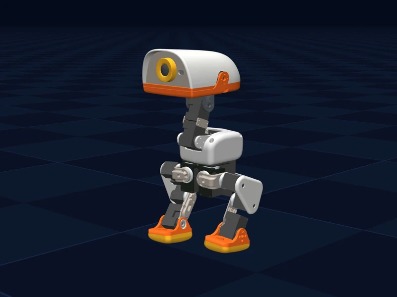

# 仿真器

仓库里的仿真模型和你手上的小鸭子是同一个硬件版本 {{hardware}}，出厂策略可以直接在电脑上运行。

<div class="duck-hero">
  <div>
    <p class="duck-kicker">MUJOCO · 仿真</p>
    <p class="duck-lead">在电脑里先跑一遍出厂动作</p>
    <p>不用连接真机。看策略走路只需 CPU；课程里训练策略时再用显卡。</p>
  </div>
  
</div>

## 安装

需要 [uv](https://docs.astral.sh/uv/)。第一次安装要下载不少依赖，需要几分钟。

```bash
git clone https://github.com/Xbotics-Embodied-AI-club/Xbotics-MiniDuck-Course.git
cd Xbotics-MiniDuck-Course
uv sync
```

## 看出厂策略走路

```bash
uv run python training/run_policy_viewer.py --skill velstand-flat
```

<figure class="duck-figure">
  <video class="duck-motion" controls muted playsinline preload="none" width="540" height="540" poster="_static/deck/walk.webp" src="_static/deck/walk.mp4" aria-label="小鸭子仿真行走动画"></video>
  <figcaption>先看动作效果，再运行上面的命令；实际窗口的按键见下表。</figcaption>
</figure>

弹出 MuJoCo 窗口后，在运行这条命令的终端里按键控制：

| 按键 | 动作 |
| --- | --- |
| `W`、`S` | 前进、后退 |
| `A`、`D` | 转向 |
| `J`、`L` | 横向平移 |
| 空格 | 立刻停下 |
| `R` | 重置 |
| `Q` | 退出 |

## 看其他动作

坐立策略用第一个指令值区分坐下和站立：`--vx 1` 表示坐下，不带这个参数表示站立。

```bash
uv run python training/run_policy_viewer.py --skill standup --start prone   # 从趴下的姿势起身
uv run python training/run_policy_viewer.py --skill sitstand --vx 1         # 坐下
uv run python training/run_policy_viewer.py --skill sitstand                # 保持站立
```
